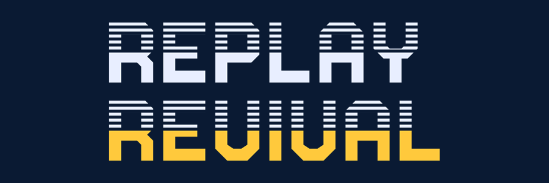
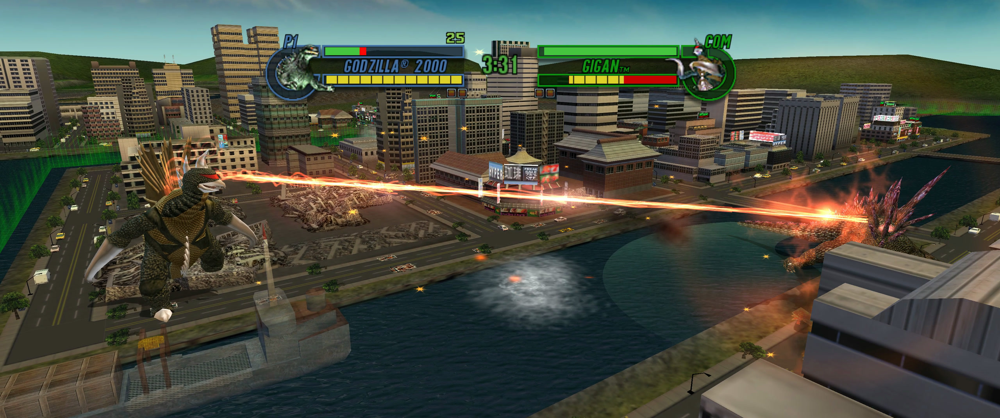
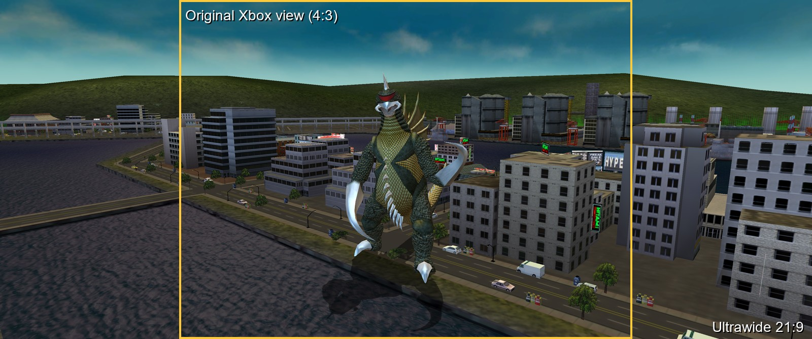
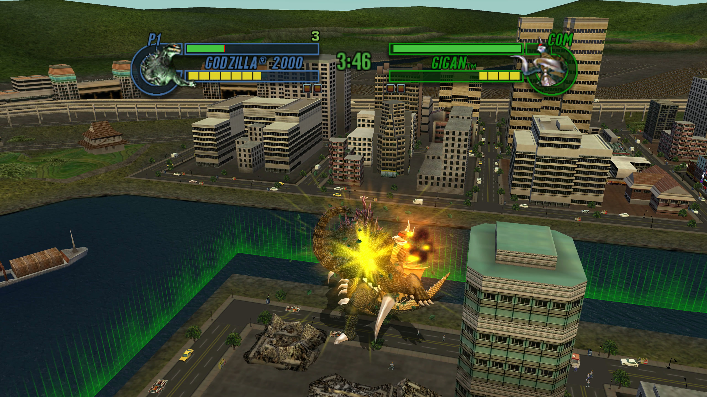
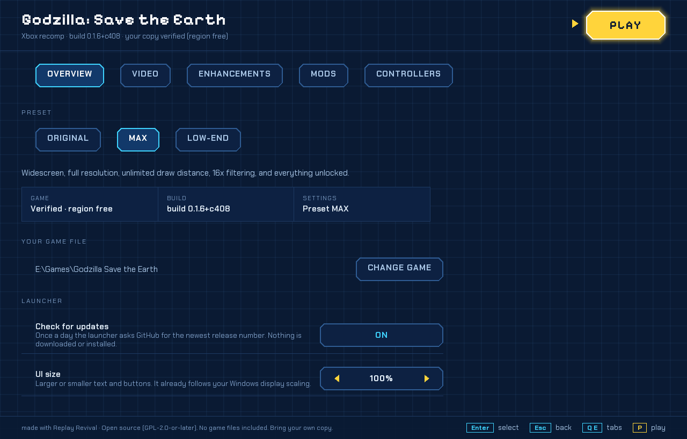
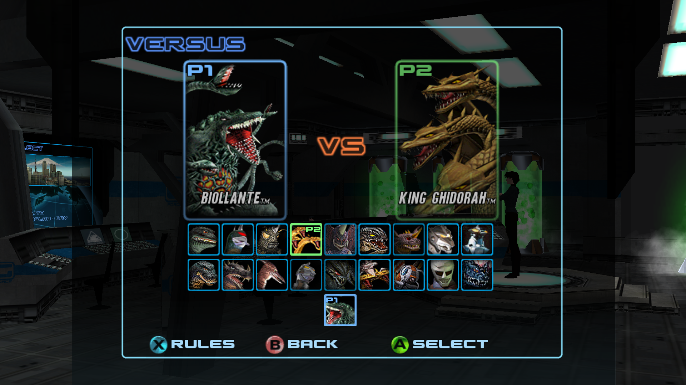

<p align="center">
  
</p>

<h3 align="center">Godzilla: Save the Earth, rebuilt to run natively on your PC:<br>widescreen, 4K, 60 fps, modern controllers.</h3>

<p align="center">
  <a href="https://github.com/replayrevival/ste-recomp/releases/latest"></a>
  <a href="LICENSE"></a>
  
  
</p>



*Godzilla 2000's atomic breath hits Gigan in Tokyo at 21:9 ultrawide, with Unlimited draw distance: the whole street, Mount Fuji and the original HUD in view.*

## What you get

| | |
|---|---|
| 🖥️ **Widescreen and ultrawide** | 16:9, 21:9 ultrawide and wider screens show more of the city. Nothing is stretched. |
| 🔍 **4K and 60 fps** | Sharp at up to 4K. The game runs at 60 frames per second and at the correct speed. |
| 🏙️ **Unlimited draw distance** | See the whole city at a smooth 60 fps. |
| 🎮 **Any controller** | Use almost any gamepad, remap every button, and pick Xbox, PlayStation or original Xbox button pictures. |
| 🚀 **A friendly launcher** | Pick a preset, change settings, set up controllers and press Play. No config files. |
| 🎛️ **In-game menu** | Press Back and Start or F1 to change settings or go back to the launcher without leaving the game. |
| 🧩 **Mods** | Install and switch mods from the launcher, including mods that change the game's own files without sharing them. Your game files are never changed. |
| 🎯 **Original gameplay by default** | The ORIGINAL preset plays the game as it was. Extras are optional. |
| 🆓 **Free and open source** | GPL licence. The source is in this repository. |



*The same moment: the original 4:3 view on the left, 21:9 on the right.*



*Unlimited draw distance: the Tokyo skyline runs all the way to the hills and the harbour.*

## Play it in 3 steps

1. **Download** the zip from [Releases](https://github.com/replayrevival/ste-recomp/releases/latest) and unpack it anywhere.
2. **Run the launcher** (`launcher.exe`) and point it at your own copy of the game: a disc image (.iso) or a folder.
3. **Press PLAY.**



## What you need

- Your own **Xbox copy of Godzilla: Save the Earth** (a backup of your disc, as an .iso, or the files in a folder).
- **Windows 10 or 11**, 64-bit.
- A graphics card that supports **DirectX 11**.
- A controller is recommended. The keyboard works too.

## What's new in v0.4.3

**After updating, open the launcher and press PLAY once** so your script mods are rebuilt from your own game files (a few seconds).

- **Fixed:** with the Biollante mod on, the character grid no longer overlaps the screen above it. On the Solo Destruction screen the top row of tiles used to cover the bottom of the portrait card and the stats panel (also when a fourth icon wraps). The grid is a little smaller and sits under the panel and above the Back/Select hints, on every select screen and in 16:9, 21:9 and 4:3. With the mods off nothing changed.
- **Still waiting for details:** a black picture during the attract movie and the globe on the ultrawide main menu (Fullscreen or Borderless? does the globe stay or only flash while going back?). If you see one, please [open an issue](https://github.com/replayrevival/ste-recomp/issues).
- Biollante's third-row idea is inspired by ANILORAK's research (our own code; no code from ANILORAK used). Full credits: [CREDITS.md](https://github.com/replayrevival/ste-recomp/blob/main/CREDITS.md).

## What's new in v0.4.2

**After updating, open the launcher and press PLAY once** so your script mods are rebuilt from your own game files (a few seconds).

- **Fixed:** with the Biollante mod on, Biollante is always shown with her icon and can be picked on every profile. Before, her tile looked like a dark empty square until the profile had unlocked her (or "unlock all monsters" was on).
- **Still waiting for details:** a black picture during the attract movie and the globe on the ultrawide main menu (which screen mode, Fullscreen or Borderless? does the globe stay or only flash while going back?). If you see one, please [open an issue](https://github.com/replayrevival/ste-recomp/issues).
- Biollante's third-row idea is inspired by ANILORAK's research (our own code; no code from ANILORAK used). Full credits: [CREDITS.md](https://github.com/replayrevival/ste-recomp/blob/main/CREDITS.md).

## What's new in v0.4.1 (hotfix)

**After updating, open the launcher and press PLAY once.** The Mods tab shows "Needs build" and your script mods are rebuilt from your own game files (a few seconds). The launcher swaps in the new Solo Destruction mod by itself; your on/off choices stay.

- **Fixed:** after SOLO DESTRUCTION (or backing out of it), Versus, Action and Melee could open the Solo select screen. It is cleared properly now.
- **Fixed:** the SOLO DESTRUCTION title now looks like the VERSUS title (same font, size and colour).
- **Fixed:** a crash that could happen when the network link was forced up with an environment variable. Normal play was not affected.
- **Not reproduced yet, details wanted:** the Biollante tile on the Solo select screen, a black picture during the attract movie, and the globe on the ultrawide main menu. If you see one, please [open an issue](https://github.com/replayrevival/ste-recomp/issues) (Windows version, graphics card, aspect ratio, what you did).
- Solo Destruction is inspired by ANILORAK's research (our own code; no code from ANILORAK used). Full credits: [CREDITS.md](https://github.com/replayrevival/ste-recomp/blob/main/CREDITS.md).

## What's new in v0.4.0



- **Biollante is playable.** She has her own place on a new third row of the character select screen. Play her as player 1, as the computer opponent, or with a **second human player on a second pad**, in Versus, Melee, Action mode and Solo Destruction. Her models, animations, HUD and sounds are the original game's own; nothing of the game is in the download. The mod holds only a recipe, and your PC builds it from **your own game files** when you press Play. It is switched off until you turn it on in the launcher's **Mods** tab. Biollante's data is the retail game's; the third select row is inspired by ANILORAK's research (our own code; no code from ANILORAK used). Step by step: the **[guide](https://github.com/replayrevival/launcher/blob/main/docs/MODDING.md#mods-that-are-built-on-your-pc-script-mods)**.
- **Solo Destruction.** A new SOLO DESTRUCTION row on the main menu: pick any monster and any city and destroy at your own pace, with a round length of 1 to 10 minutes or no time limit. Built the same way (from your own game files), switched off until you turn it on. Inspired by ANILORAK's Godzilla Ultra research (our own code; no code from ANILORAK used).
- **Mods can be combined.** Solo Destruction and Biollante work together; if two mods ever change the same thing, the launcher tells you which two.
- **Photo mode.** Pause a fight and fly a free camera: wider or narrower view, roll, hide the HUD and save full-resolution PNG screenshots. Open it from the in-game menu, with F8, or by holding Back and Y.
- Everything from 0.2.3 is in it too: sound packs, retexturing any monster, instant name typing, playing straight from your disc image, the controller-only in-game menu, borderless Fullscreen, and the "G:STEM-inspired options" (inspired by G:STEM, our own code).

Making mods? See the [modding guide](https://github.com/replayrevival/launcher/blob/main/docs/MODDING.md), including "Add a monster to the roster".

**Known issues:** when the select screen reopens, a monster in the third row is not preselected; the Solo Destruction title is English only; in photo mode the HUD clock picture keeps counting while it is shown; in Tokyo a UFO can leave the playing area; Unlimited draw distance can still show buildings popping in and out at the far skyline (not fixed, not verified either way); looping a replaced sound is untested. The full list is in the release notes.

**Credits:** [CREDITS.md](https://github.com/replayrevival/ste-recomp/blob/main/CREDITS.md) lists everything we used (code and assets, with licences) and everyone whose research or ideas inspired us (nothing of theirs is included).

## FAQ

**Do I need the game?** Yes. This project contains none of the game. You need your own copy.

**Is this an emulator?** No. An emulator pretends to be the console and runs the original game inside it. Here the game's own program was translated once into a normal Windows program, so it runs on your PC like any other game.

**Is it legal?** The project includes no game code and no game files, and you must own the game. It is an unofficial fan project. Laws differ from country to country, and this is not legal advice.

**Why the Xbox version?** The Xbox release has the sharpest textures and effects of the original versions, so it's the best starting point.

**Can I mod it?** Yes. The launcher installs mods from a zip or a folder, and there is a step-by-step guide for retexturing a monster, file mods, patch mods and every setting you can change: the [modding guide](https://github.com/replayrevival/launcher/blob/main/docs/MODDING.md). Mods must never contain game files.

**Linux, Mac or Steam Deck?** Windows only for now. Linux and Mac are planned for later. A guide for trying it with Proton on Linux is in [docs/TESTING_PROTON.md](docs/TESTING_PROTON.md), but it is not officially supported yet.

**Where do I report bugs?** If the game stops, press **Save crash report** in the launcher and attach the zip to an [issue](https://github.com/replayrevival/ste-recomp/issues) after you have looked it over. Please add your Windows version, graphics card and what you did. Never attach game files.

## Disclaimer

This is an unofficial fan project. It is not affiliated with or endorsed by the game's publishers or rights holders (Toho, Atari or Pipeworks). No game files are included. Godzilla and all related names and trademarks belong to their owners. You must own the game.

---

# For developers

> **Early alpha.** Work in progress. Expect bugs and rough edges.

> **No game code and no game data are published here.** The recompiled C is generated on your machine from your own copy of `default.xbe` (see [BUILD.md](BUILD.md)) and is git-ignored.

## How it works
This is a native PC *static recompilation* of **Godzilla: Save the Earth** (Xbox, 2004). The game's own x86 code is translated to C once, compiled for Windows, and run against a small replacement of the Xbox kernel, GPU (NV2A "Kelvin" to Direct3D 11), audio and USB hardware. There is no emulator and no game data in this repository.

## Why this exists
A personal passion project, built over several months with limited resources, so the game can be played on modern machines at modern resolutions without compatibility problems. If the Godzilla community gets something out of it too, even better.

It is **AI-assisted**: much of the reverse-engineering and recompilation work was done with AI tools, guided and tested by a human. You are free to ignore that, or to use the work to help keep the games we love alive.

## What is in this repository
| Path | What |
|---|---|
| `xboxrecomp/` | Runtime libraries (kernel, Direct3D 8 and NV2A "Kelvin" to Direct3D 11, MCPX audio and DSP, USB/OHCI, input, video) and the recompiler/generator (`xboxrecomp/tools/recomp`). Based on [sp00nznet/xboxrecomp](https://github.com/sp00nznet/xboxrecomp) v0.14.0 with this project's changes; see `xboxrecomp/NOTICE` and [THIRD_PARTY_NOTICES.md](THIRD_PARTY_NOTICES.md). |
| `ste/src/` | The game-specific executable: `main.c` (start-up, command line, crash handling), `recomp_manual.c` (hand-written replacements and options), `ste_pb_hook.c` (per-frame hook, window, dumps, watchdog), `ste_sdlinput.c` (SDL3 gamepads). |
| `ste/gen/` | Inputs of the generator: `functions.tsv` (function address ranges), `ste_hooks.toml` (instruction hooks), `exclude_manual.c` (functions replaced by hand). Addresses only. |
| `ste/scripts/` | `build.ps1` (whole build), `generate.py` (code generation from your XBE), `verify_generated.py` (regression checks on the generated code). |
| `docs/` | [LAUNCHER_INTERFACE.md](docs/LAUNCHER_INTERFACE.md) (command line, environment, ini keys, exit codes, log lines), [XDK_FUNCTIONS.md](docs/XDK_FUNCTIONS.md) (what is recompiled and what is replaced), file formats, hooks. |

The launcher (game folder picker, presets, settings, mods) is a separate program in [replayrevival/launcher](https://github.com/replayrevival/launcher).

## Building
Windows 10/11, Visual Studio 2022 Build Tools, CMake, Python 3, and your own extracted `default.xbe`:

```
.\ste\scripts\build.ps1 -Xbe "D:\path\to\extracted\default.xbe"
```
Details, expected output and the validation steps are in [BUILD.md](BUILD.md).

## Running from the command line
`ste-recomp.exe --game <folder that contains default.xbe>`; options are read from `ste_video.ini` / `ste_enhance.ini` (see [docs/LAUNCHER_INTERFACE.md](docs/LAUNCHER_INTERFACE.md)). A disc image (`--game <file.iso>` or `.xiso`) is mounted read-only by the game program itself (nothing is unpacked); a folder works too.

## Licence and credits
The gameplay options grouped as "G:STEM-inspired options" in the Enhancements settings are inspired by G:STEM's research and gameplay options (our own code; no code from G:STEM used): thanks to Gojirex, Shame Devs, GR8GODZILLAGOD and the STEM community. Solo Destruction is inspired by ANILORAK's Godzilla Ultra research (our own code; no code from ANILORAK used). **Credits:** every project and person we used or learned from is listed in [CREDITS.md](CREDITS.md), in two parts: code and assets that are included (with licences), and research and inspiration (nothing included).

Own code: **GPL-2.0-or-later** (see [LICENSE](LICENSE)). Third-party components keep their own licences ([THIRD_PARTY_NOTICES.md](THIRD_PARTY_NOTICES.md), [CREDITS.md](CREDITS.md), `xboxrecomp/NOTICE`). Binary releases are published together with the matching source from this repository.
