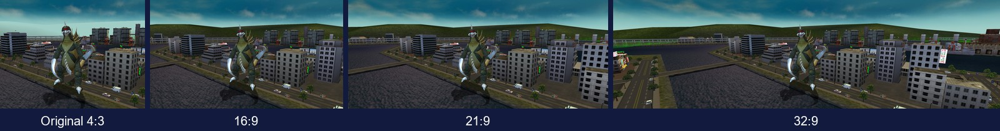
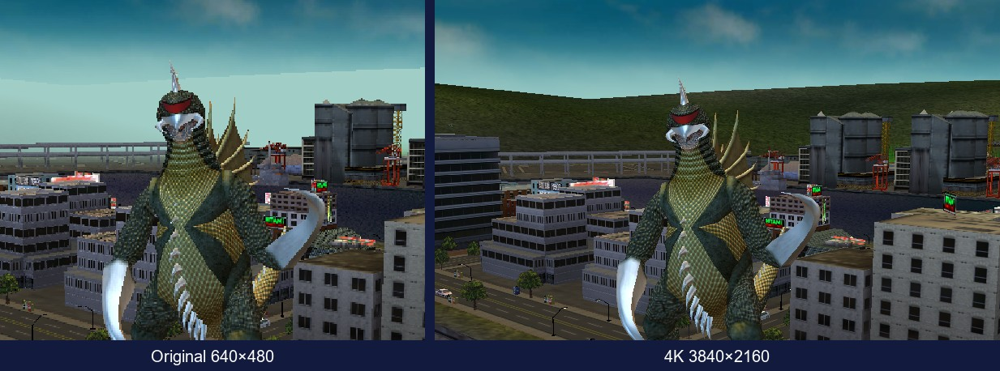
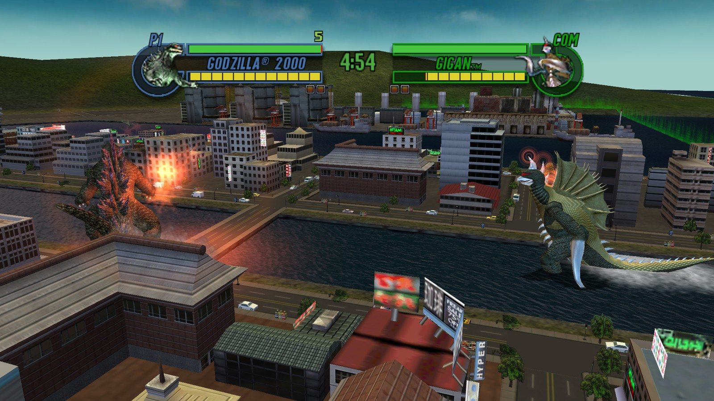
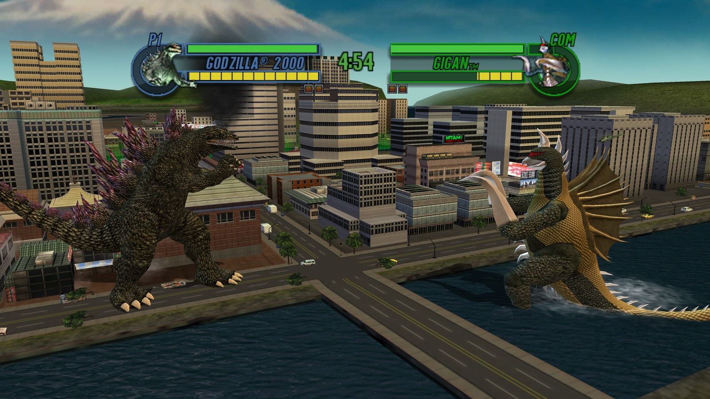
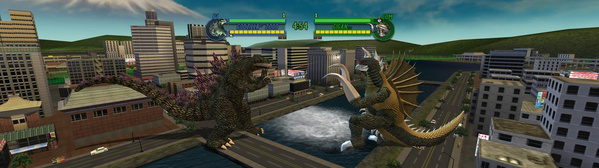
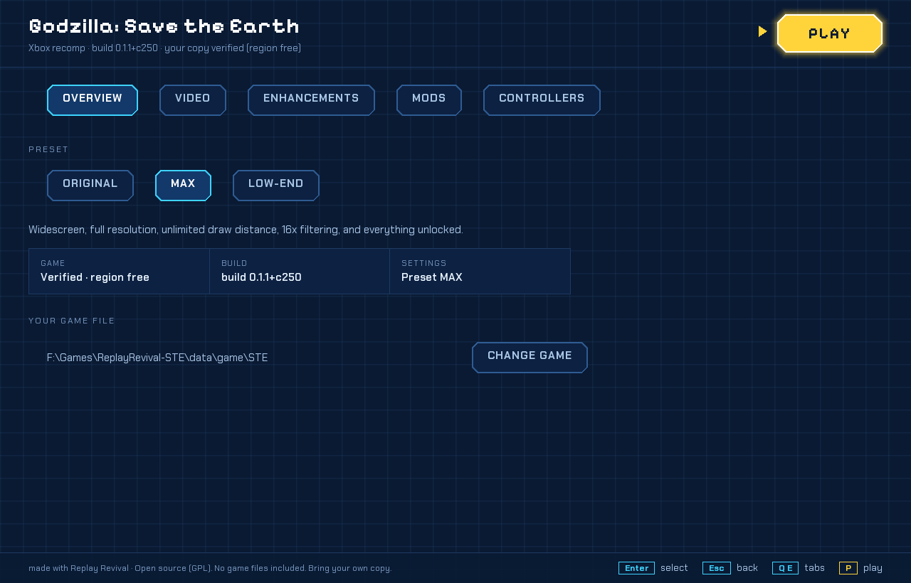
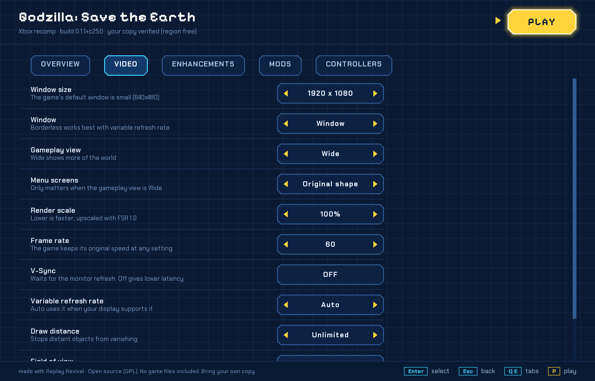

# Godzilla: Save the Earth — Recompiled
*A Replay Revival project*
   
A native PC static recompilation of **Godzilla: Save the Earth** (Xbox, 2004), so the game can be
played on modern hardware at modern resolutions, without emulation.

> **Very early alpha.** Expect bugs, missing features and rough edges.

## Why this exists
This is a personal passion project, built over several months with limited resources. I made it
so I could play this game with my kids, and with this generation, without outdated resolutions
and compatibility problems. If the Godzilla gaming community gets something out of it too, even
better.

This project is **AI-assisted**: much of the reverse-engineering and recompilation work was done
with the help of AI tools, guided and tested by a human. I know not everyone agrees with that
approach. You're free to ignore it, or to use it to help keep the games we love alive.

## Requirements
- Windows 10/11 (64-bit) with a Direct3D 11 GPU (runtime DLLs included)
- **Your own copy of the Xbox version**, as a disc image (.iso) or extracted folder. An .iso is unpacked automatically on first use. No game files are included or distributed.
- Windows "N" editions need the Media Feature Pack.

## Getting started
1. Download the latest release from the [Releases](../../releases) page.
2. Extract it to a folder you can write to (not Program Files).
3. Run `launcher.exe`, choose your disc image or extracted game folder, pick a preset and press Play.

## Status
**Working:** boots and plays, .iso loading, fights playable, launcher with video presets and settings,
Xbox controllers detected, with dead zone and rumble settings.
**Not yet:** button remapping in game, some distant buildings still
pop in, PlayStation/Switch pads untested, in-game overlay unfinished.

## Screenshots

*Same moment, original 4:3 view vs 21:9 — true widescreen, nothing stretched*

*Original 4:3, 16:9, 21:9 and 32:9 views of the same scene.*

*Original 640×480 compared with 4K 3840×2160 using the same crop.*

### Action gallery

*1080p action shot with the original HUD visible.*

*4K action shot with the original HUD visible.*

*21:9 action shot with the original HUD centered.*

*32:9 action shot with the original HUD centered.*

### Launcher

*Launcher Overview tab.*

*Launcher Video tab.*

## Roadmap
1. Stable widescreen and high resolutions, locked 60 fps
2. Controller remapping in game, wider controller testing
3. Optimisation (4K 60 on capable PCs, 1080p 60 on low-end PCs)
4. Enhancements and toggles, including restoring Biollante, who is unused on the disc
5. Linux (and maybe Mac) support
6. Longer term: a full decompilation, laying the groundwork for future Godzilla recomp projects

## Reporting bugs
Open an [issue](../../issues) with your Windows version, GPU, and what happened.

## Legal
Not affiliated with or endorsed by Toho, Atari or Pipeworks. Godzilla and all related trademarks
belong to their respective owners. This project does not include any game assets; you must own
a legal copy of the game to use it.

Licensed under the GPL-3.0. See [LICENSE](LICENSE) and [CREDITS](CREDITS.md).
