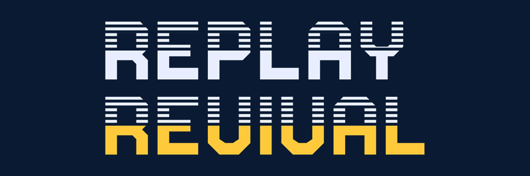
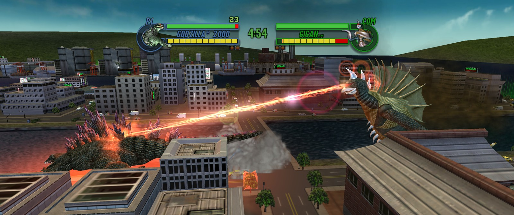
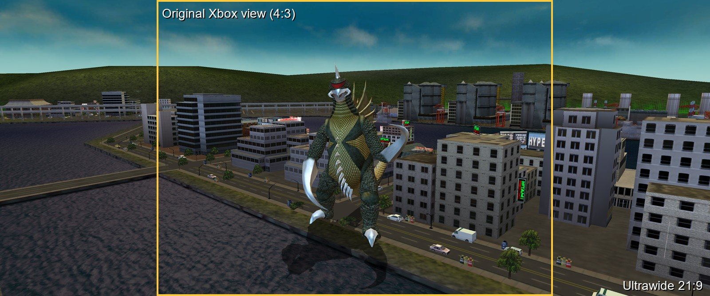
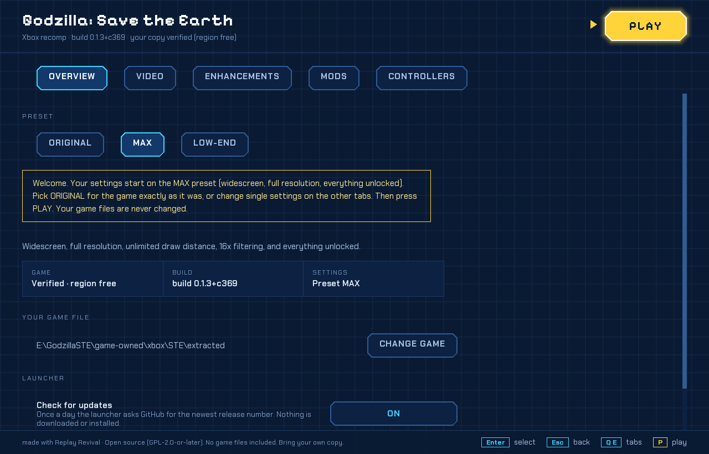
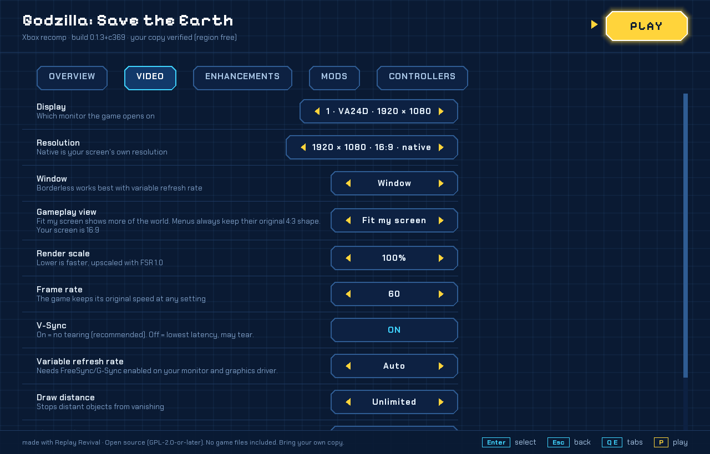
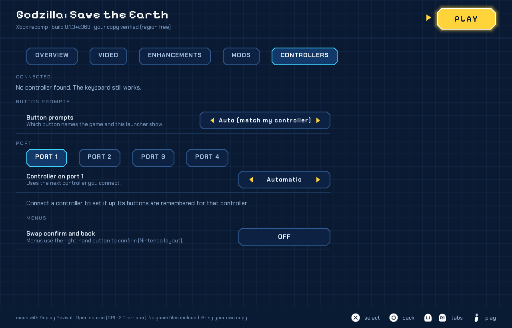

<p align="center">
  
</p>

<h3 align="center">Godzilla: Save the Earth, rebuilt to run natively on your PC:<br>widescreen, 4K, 60 fps, modern controllers.</h3>

<p align="center">
  <a href="https://github.com/replayrevival/ste-recomp/releases/latest"></a>
  <a href="LICENSE"></a>
  
  
</p>



*A fight at 3440x1440 ultrawide. Same game, same HUD, nothing stretched.*

## What you get

| | |
|---|---|
| 🖥️ **Widescreen and ultrawide** | 16:9, 21:9 and even 32:9 screens show more of the city. Nothing is stretched. |
| 🔍 **4K and 60 fps** | Sharp at up to 4K. The game runs at 60 frames per second and at the correct speed. |
| 🏙️ **Unlimited draw distance** | See whole skylines instead of buildings popping in. |
| 🎮 **Any controller** | Use almost any gamepad, remap every button, and pick Xbox, PlayStation or original Xbox button pictures. |
| 🚀 **A friendly launcher** | Pick a preset, change settings, set up controllers and press Play. No config files. |
| 🧩 **Mods** | Install and switch mods from the launcher. Your game files are never changed. |
| 🎯 **Original gameplay by default** | The ORIGINAL preset plays the game as it was. Extras are optional. |
| 🆓 **Free and open source** | GPL licence. The source is in this repository. |



*The same moment: the original 4:3 view on the left, 21:9 on the right.*

## Play it in 3 steps

1. **Download** the zip from [Releases](https://github.com/replayrevival/ste-recomp/releases/latest) and unpack it anywhere.
2. **Run the launcher** (`launcher.exe`) and point it at your own copy of the game: a disc image (.iso) or a folder.
3. **Press PLAY.**



## What you need

- Your own **Xbox copy of Godzilla: Save the Earth** (a backup of your disc, as an .iso, or the files in a folder).
- **Windows 10 or 11**, 64-bit.
- A graphics card that supports **DirectX 11**.
- A controller is recommended. The keyboard works too.

## What's new in v0.1.3

- No black console window opens any more when you start the game or the launcher.
- Choose Xbox, PlayStation or original Xbox button pictures. Auto follows your controller.
- The launcher has a **Mods** tab, a built-in file browser and plainer messages when something goes wrong.
- If the game stops, **Save crash report** makes a zip you can send us. Nothing is uploaded by itself.
- The launcher quietly checks once a day for a new version (you can turn it off).

[Read the full release notes](https://github.com/replayrevival/ste-recomp/releases/tag/v0.1.3-alpha).

**Coming next:** 0.1.4 (an in-game menu, volume and cursor settings, patch mods loaded by the game), then a beta, then 1.0. Linux and Mac come later.

<table>
<tr>
<td></td>
<td></td>
</tr>
</table>

## FAQ

**Do I need the game?** Yes. This project contains none of the game. You need your own copy.

**Is this an emulator?** No. An emulator pretends to be the console and runs the original game inside it. Here the game's own program was translated once into a normal Windows program, so it runs on your PC like any other game.

**Is it legal?** The project includes no game code and no game files, and you must own the game. It is an unofficial fan project. Laws differ from country to country, and this is not legal advice.

**Why the Xbox version?** The Xbox release is the one this project was built for. Other versions would need separate work.

**Can I mod it?** Yes. The launcher installs mods from a zip or a folder. See the [modding guide](https://github.com/replayrevival/launcher/blob/main/docs/MODDING.md). Mods must never contain game files.

**Linux, Mac or Steam Deck?** Windows only for now. Linux and Mac are planned for later. A guide for trying it with Proton on Linux is in [docs/TESTING_PROTON.md](docs/TESTING_PROTON.md), but it is not officially supported yet.

**Where do I report bugs?** If the game stops, press **Save crash report** in the launcher and attach the zip to an [issue](https://github.com/replayrevival/ste-recomp/issues) after you have looked it over. Please add your Windows version, graphics card and what you did. Never attach game files.

## Disclaimer

This is an unofficial fan project. It is not affiliated with or endorsed by the game's publishers or rights holders (Toho, Atari or Pipeworks). No game files are included. Godzilla and all related names and trademarks belong to their owners. You must own the game.

---

# For developers

> **Early alpha.** Work in progress. Expect bugs and rough edges.

> **No game code and no game data are published here.** The recompiled C is generated on your machine from your own copy of `default.xbe` (see [BUILD.md](BUILD.md)) and is git-ignored.

## How it works
This is a native PC *static recompilation* of **Godzilla: Save the Earth** (Xbox, 2004). The game's own x86 code is translated to C once, compiled for Windows, and run against a small replacement of the Xbox kernel, GPU (NV2A "Kelvin" to Direct3D 11), audio and USB hardware. There is no emulator and no game data in this repository.

## Why this exists
A personal passion project, built over several months with limited resources, so the game can be played on modern machines at modern resolutions without compatibility problems. If the Godzilla community gets something out of it too, even better.

It is **AI-assisted**: much of the reverse-engineering and recompilation work was done with AI tools, guided and tested by a human. You are free to ignore that, or to use the work to help keep the games we love alive.

## What is in this repository
| Path | What |
|---|---|
| `xboxrecomp/` | Runtime libraries (kernel, Direct3D 8 and NV2A "Kelvin" to Direct3D 11, MCPX audio and DSP, USB/OHCI, input, video) and the recompiler/generator (`xboxrecomp/tools/recomp`). Based on [sp00nznet/xboxrecomp](https://github.com/sp00nznet/xboxrecomp) v0.14.0 with this project's changes; see `xboxrecomp/NOTICE` and [THIRD_PARTY_NOTICES.md](THIRD_PARTY_NOTICES.md). |
| `ste/src/` | The game-specific executable: `main.c` (start-up, command line, crash handling), `recomp_manual.c` (hand-written replacements and options), `ste_pb_hook.c` (per-frame hook, window, dumps, watchdog), `ste_sdlinput.c` (SDL3 gamepads). |
| `ste/gen/` | Inputs of the generator: `functions.tsv` (function address ranges), `ste_hooks.toml` (instruction hooks), `exclude_manual.c` (functions replaced by hand). Addresses only. |
| `ste/scripts/` | `build.ps1` (whole build), `generate.py` (code generation from your XBE), `verify_generated.py` (regression checks on the generated code). |
| `docs/` | [LAUNCHER_INTERFACE.md](docs/LAUNCHER_INTERFACE.md) (command line, environment, ini keys, exit codes, log lines), [XDK_FUNCTIONS.md](docs/XDK_FUNCTIONS.md) (what is recompiled and what is replaced), file formats, hooks. |

The launcher (game folder picker, presets, settings, mods) is a separate program in [replayrevival/launcher](https://github.com/replayrevival/launcher).

## Building
Windows 10/11, Visual Studio 2022 Build Tools, CMake, Python 3, and your own extracted `default.xbe`:

```
.\ste\scripts\build.ps1 -Xbe "D:\path\to\extracted\default.xbe"
```
Details, expected output and the validation steps are in [BUILD.md](BUILD.md).

## Running from the command line
`ste-recomp.exe --game <folder that contains default.xbe>`; options are read from `ste_video.ini` / `ste_enhance.ini` (see [docs/LAUNCHER_INTERFACE.md](docs/LAUNCHER_INTERFACE.md)). Disc images (.iso) are unpacked by the launcher; the game program itself reads folders.

## Licence and credits
Own code: **GPL-2.0-or-later** (see [LICENSE](LICENSE)). Third-party components keep their own licences ([THIRD_PARTY_NOTICES.md](THIRD_PARTY_NOTICES.md), [CREDITS.md](CREDITS.md), `xboxrecomp/NOTICE`). Binary releases are published together with the matching source from this repository.
